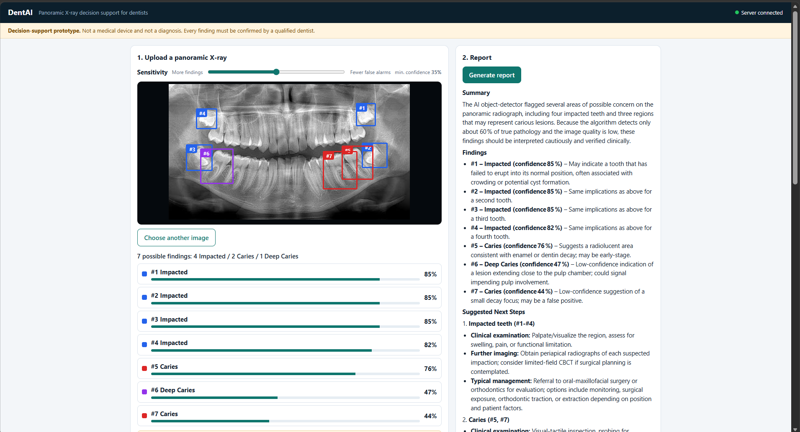
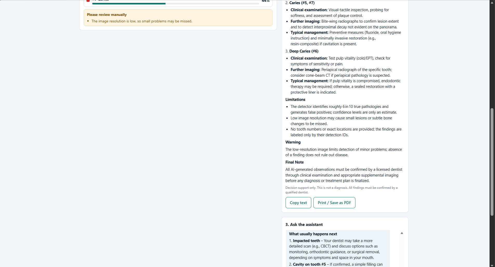

# DentAI - AI Decision Support for Dental X-rays

A web app for dentists. Upload a **panoramic dental X-ray**, and the AI marks areas that may need attention, writes a structured report with suggested next steps, and answers follow-up dental questions in a chat box.

> **Decision-support prototype. Not a medical device and not a diagnosis.** Every finding must be confirmed by a qualified dentist.

Built for an AI hackathon (October 2026).

## Demo





## What it does

1. **Detects** four kinds of findings on a panoramic X-ray and draws boxes on the image: Caries, Deep Caries, Impacted Tooth, Periapical Lesion.
2. **Sensitivity slider** lets the dentist trade more findings against fewer false alarms.
3. **Writes a report** (summary, findings, suggested next steps, limitations) using a free LLM on Groq. Printable or savable as PDF.
4. **Chat assistant** answers dental questions and can explain the findings in plain words for a patient.
5. **Safety built in:** low-confidence findings are tagged, warnings appear for low-resolution or non-panoramic images, the LLM is told not to give definitive diagnoses or invent tooth numbers, and a disclaimer is always shown.

## How it works

```
Dentist uploads X-ray -> web page (port 5600) -> FastAPI backend (port 8000)
                                                    |-- YOLOv8s detector -> boxes
                                                    |-- Groq LLM -> report and chat answers
```

- **Frontend:** one HTML file (`frontend/index.html`), plain HTML/CSS/JavaScript, no build step.
- **Backend:** FastAPI (`backend/main.py`) with endpoints `/health`, `/detect`, `/report_xray`, `/chat`, plus `/analyze` and `/report` for single-tooth crops.
- **Detector:** YOLOv8s trained on the DENTEX panoramic dataset, running on CPU.
- **LLM:** `openai/gpt-oss-120b` through the free Groq API.

## Results (honest numbers)

Detector, tested on 105 held-out DENTEX panoramic X-rays:

| Class | Precision | Recall | mAP50 |
|---|---|---|---|
| **All classes** | 0.553 | 0.602 | **0.564** |
| Impacted Tooth | 0.80 | 0.90 | 0.84 |
| Caries | 0.45 | 0.59 | 0.50 |
| Deep Caries | 0.42 | 0.53 | 0.47 |
| Periapical Lesion | 0.54 | 0.39 | 0.44 |

In plain words: the model finds roughly **6 in 10** of the problems marked by dentists, and about **half** of its flags are real. It is strongest on impacted teeth and weaker on caries and periapical lesions.

Caveats:
- The same 105 images were used to pick the best training epoch, so real-world results are likely a little lower.
- The training set is small (600 images), so results will vary on X-rays from other machines or clinics.
- Test-time augmentation and higher resolution gave no meaningful gain, so the final setup uses 1024 px with no augmentation.

A separate single-tooth classifier (EfficientNet-B0, `/analyze`) was also trained on the Kaggle crop dataset. It found 57% of the cavities in its 21-image test set (macro-F1 about 0.77). It does not work on full X-rays, so the main web page does not use it.

## Run it locally

Requirements: Python 3.12, Windows/Linux/macOS, a free [Groq API key](https://console.groq.com).

```bash
git clone https://github.com/Dhananjay-TheAIMind/dental-ai-assistant.git
cd dental-ai-assistant
python -m venv venv
venv\Scripts\activate          # Windows (use: source venv/bin/activate on Linux/macOS)
pip install -r requirements.txt --extra-index-url https://download.pytorch.org/whl/cpu
```

**Model weights are not stored in git.** Download `xray_detector.pt` (and `tooth_classifier_v2.pt` for the optional single-tooth endpoint) from the repository's Releases page and place them in `ml/models/`.

Create `backend/.env` with your own key (this file is git-ignored):

```
GROQ_API_KEY=your_key_here
LLM_MODEL=openai/gpt-oss-120b
```

Start the backend, then the page, in two terminals:

```bash
python -m uvicorn backend.main:app --reload
python -m http.server 5600 --bind 127.0.0.1 --directory frontend
```

Open http://127.0.0.1:5600. The top right should show a green dot and "Server connected". API docs are at http://127.0.0.1:8000/docs.

## Project structure

```
backend/    FastAPI app (main.py)
frontend/   Single-page web UI (index.html)
ml/         Training and evaluation scripts, model configs (weights go in ml/models/)
notebooks/  Colab notebooks used for training
docs/       Screenshots and notes
```

## Limitations

- Works on **panoramic** X-rays only. Periapical (close-up) images are a different image type and give unreliable results.
- Detects four categories only. It does not report tooth numbers, bone loss, or other conditions.
- Misses some problems and raises false alarms. Absence of a finding does not rule out disease.
- Small training set and a single data source.
- The report and chat need an internet connection (Groq).
- Research and demonstration only.

## Future work

- Periapical X-ray support and bone-loss measurement using open datasets such as DenPAR (CC BY 4.0).
- Tooth numbering, so findings can be tied to a specific tooth.
- Larger, more varied training data and external validation with dentists.
- Offline mode with a local language model.

## Data and credits

- **DENTEX** panoramic dataset (Hamamci et al.), licensed **CC BY-NC-SA 4.0**. Used to train the detector. Because of this licence, the trained model and this project are for **non-commercial** use only. Paper: https://arxiv.org/abs/2305.19112
- **Dental Radiography** dataset on Kaggle (abbasseifossadat), used for the single-tooth classifier.
- Detector built with [Ultralytics YOLOv8](https://github.com/ultralytics/ultralytics). LLM served by [Groq](https://groq.com).

## Disclaimer

This software is a research prototype for decision support only. It is not approved for clinical use, does not provide a medical diagnosis, and must not replace the judgment of a qualified dentist.
